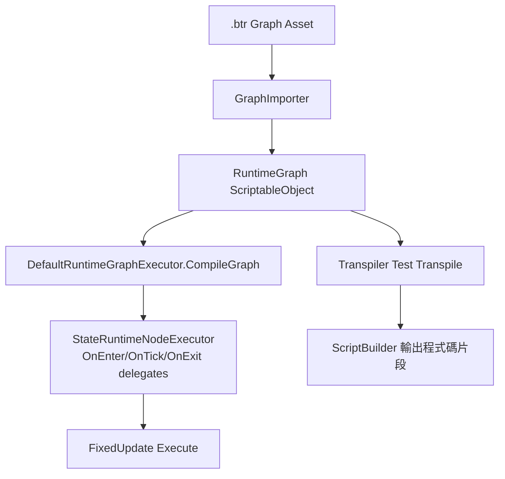
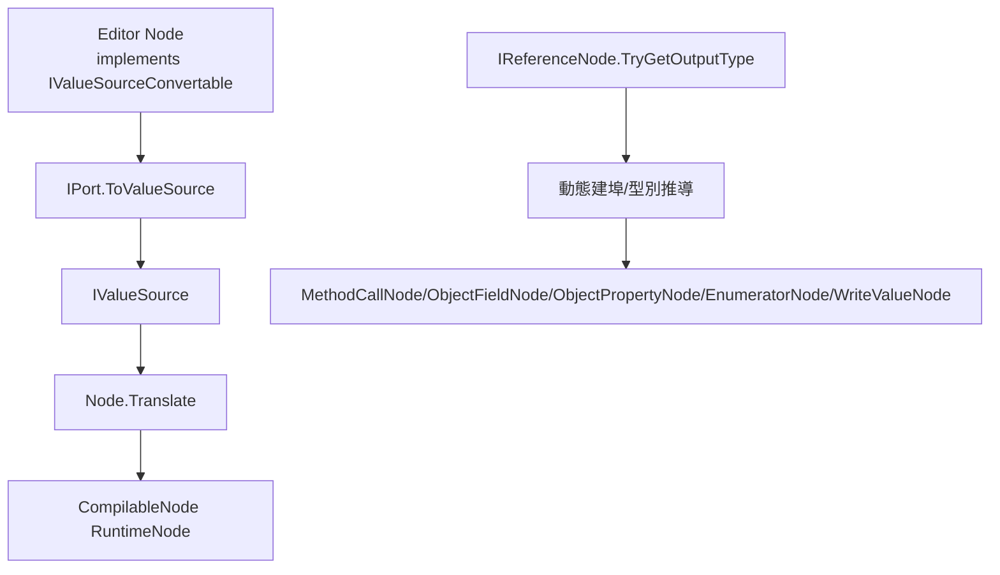
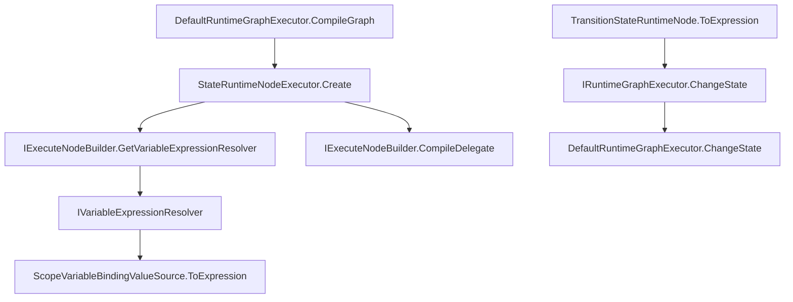

# Behaviour Tree Editor

`BehaviourTreeEditor` 是一個基於 Unity GraphToolkit 的**圖形化狀態樹編輯器**（目前開發中）。
核心目標是：

- 以「State + 事件流程（OnEnter / OnTick / OnExit）」定義行為
- 透過節點連線完成狀態轉換與資料更新
- 將圖轉為 `RuntimeGraph`，在執行時用 **Linq Expression** 編譯並執行
- 逐步補齊**靜態程式碼生成（Transpiler）**能力

---

## 1. 專案現況（摘要）

- ✅ 已有完整的圖形資產匯入流程：`.btr` → `RuntimeGraph`
- ✅ 已有 Runtime 執行器：`DefaultRuntimeGraphExecutor`
- ✅ 支援常見節點：條件、運算、邏輯、欄位/屬性讀寫、方法呼叫、迭代、狀態切換
- ✅ 已有 Editor 測試覆蓋核心行為（Condition / MethodCall / Write / Enumerator）
- 🚧 靜態程式碼生成尚在建置中（目前可輸出片段，非完整產物）

---

## 2. 目錄結構

```text
BehaviourTreeEditor/
├─ Editor/                     # Graph 節點模型、驗證、匯入器
│  ├─ Composition/             # Sequence / Selector / Enumerator
│  └─ Variable/                # 變數綁定與參照節點
├─ Runtime/                    # RuntimeGraph、RuntimeNode、執行器、ValueSource、Transpiler
│  └─ ValueSource/             # 各種值來源（常數、欄位、屬性、邏輯、比較...）
├─ Test/Editor/                # NUnit 測試
├─ Behaviour Tree Graph.btr    # 範例圖
├─ TestScene.unity             # 範例場景
└─ TestScript.cs               # 範例腳本
```

---

## 3. 核心資料流



### 匯入階段（Editor）

`GraphImporter` 會把 `Graph` 轉成 `RuntimeGraph`：

1. 外層圖（State Tree）轉成 `StateRuntimeNode` 清單
2. 每個 State 的子圖（OnEnter/OnExit/OnTick）轉成 `CompilableNode` 清單
3. 建立節點索引與連線 (`NextNodeIndices`)
4. 收集 Variables / Constants 綁定
5. 收集 `RequiredResolveTypes`（執行時需要注入的型別）

---

## 4. 圖模型與執行模型

## 圖模型

- `Graph`：外層狀態圖（副檔名 `.btr`）
- `StateTreeGraph`：每個狀態的子圖
- `StartNode`：外層樹根
- 外層子圖節點（`ISubgraphNode`）代表一個 State

## Runtime 模型

- `RuntimeGraph`
  - `States : List<StateRuntimeNode>`
  - `Variables / Constants : List<IVariableBinding>`
  - `RequiredResolveTypes : List<SType>`
- `StateRuntimeNode`
  - `OnEnter / OnExit / OnTick : List<CompilableNode>`
  - `ParentIndex` / `NextNodeIndices`

## 執行器

`DefaultRuntimeGraphExecutor` 在 `CompileGraph` 時：

- 以 Expression 將每個 state event 編譯成 delegate
- 建立 resolver（型別 → 實例）
- 初始化變數/常數預設值
- 自動走到預設葉節點路徑

每個 `FixedUpdate`：

- 依照當前 `Path` 依序執行各層 `OnTick`
- 若中途 `ChangeState`，會重新切路徑（含 LCA 計算、OnExit/OnEnter 呼叫）
- 每幀有 break-path 次數上限（目前 5）避免無限切換

---

## 5. 節點系統（目前主要節點）

## 流程/狀態節點

- `StartNode`
- `OnEnterNode` / `OnExitNode` / `OnTickNode`
- `CompositionNode` / `SequenceNode` / `SelectorNode`
- `ConditionNode`
- `TransitionStateNode`

## 資料/計算節點

- `WriteValueNode`
- `MethodCallNode`
- `OperationNode`（+ - * /）
- `EqualityNode`（< > <= >= ==）
- `LogicalNode`（And/Or/Xor/Not）
- `EnumeratorNode`
- `LogNode`

## 參照節點（型別/欄位/屬性）

- `ReferenceNode`
- `ReferenceFieldNode` / `ReferencePropertyNode`
- `ObjectFieldNode` / `ObjectPropertyNode`

## 變數節點

- `VariableBindings`（根圖 context，支援 Int/Float/UInt）
- `VariableReference`（可讀寫）
- `ConstantReference`（唯讀）

---

## 6. 變數與依賴注入

## Variables / Constants

- 在外層圖放 `VariableBindings` context 並新增 binding block
- 匯入後進入 `RuntimeGraph.Variables / Constants`
- State 子圖可用 `VariableReference` / `ConstantReference` 讀取
- `VariableReference` 接上流程 input 後可顯示寫入端口（Write）

## Resolver 注入

許多 `ValueSource`（例如 class instance field/property/method）需要 resolver 取得實例。

`DefaultRuntimeGraphExecutor` 提供兩種方式：

1. `RegisterInstance<T>(obj)`：手動註冊
2. `AutoInstanceTypes`：自動建立實例並註冊

此外，匯入器會收集 `RequiredResolveTypes`，可用來檢查是否有漏注入型別。

---

## 7. 靜態程式碼生成（Transpiler）現況

`Runtime/Transpiler.cs` 目前提供 `Test Transpile`（ContextMenu）示範流程：

- 取第一個 runtime graph
- 取第一個非 Root state 的 `OnEnter` 節點鏈
- 呼叫 `BuildScript(...)` 產生程式碼片段
- 輸出到 Console 並複製到剪貼簿

目前是「節點級腳本輸出能力」階段，尚未形成完整 class/file 產物。

---

## 8. 範例與測試

## 範例

- `TestScene.unity`
  - `Square` 物件上掛有：
    - `TestScript`
    - `DefaultRuntimeGraphExecutor`
- `Behaviour Tree Graph.btr`：範例圖資產

`TestScript` 在 `Awake` 會對 `DefaultRuntimeGraphExecutor` 註冊 `CharacterStateMachineContext`，
示範 runtime resolver 的注入方式。

## 測試

位於 `Test/Editor/`：

- `ConditionRuntimeNodeTest`
- `MethodCallTest`
- `WriteValueTest`
- `EnumeratorRuntimeNodeTest`

覆蓋重點包括：Expression 執行、ref 參數方法呼叫、巢狀欄位寫入、集合迭代。

---

## 9. 已知限制 / 注意事項（目前版本）

1. **靜態程式碼生成尚未完整**
   - `ScopeVariableBindingValueSource` 的 `TargetType` / `DeclareVariableBinding` 尚未完成
   - `TransitionStateRuntimeNode` 尚未覆寫 `BuildScript`
2. `ConditionRuntimeNode.BuildScript` 目前固定輸出 `==`，尚未反映 `NotEqual`
3. 變數綁定型別目前僅內建 `int / float / uint`
4. 外層 `Graph` 只接受特定節點類型（非支援節點會在 GraphLogger 報錯）
5. State 名稱應保持唯一（轉換時以名稱建立字典）

---

## 10. 後續擴充建議

- 補齊 Transpiler 端對所有節點/ValueSource 的 `BuildScript` 支援
- 產生完整 C# 類別檔（含 context 型別、state dispatch、變數初始化）
- 增加變數綁定型別（bool、string、Vector2/3 等）
- 擴充測試到整體狀態切換路徑與熱更新流程

---

## 11. 主要程式入口（快速索引）

- Graph 定義：`Editor/Graph.cs`
- 匯入器：`Editor/GraphImporter.cs`
- Runtime Graph：`Runtime/RuntimeGraph.cs`
- Runtime Node 基底：`Runtime/RuntimeNode.cs`
- 執行器：`Runtime/DefaultRuntimeGraphExecutor.cs`
- Transpiler：`Runtime/Transpiler.cs`
- ValueSource：`Runtime/ValueSource/*.cs`

---

## 12. 介面實作說明（Interface Implementations）

以下只列專案內自定義介面（不含外部套件介面）。

### 12.1 Editor 層介面

| 介面 | 主要實作 | 主要用途 | 主要呼叫端 |
|---|---|---|---|
| `IValueSourceConvertable` (`Editor/Node.cs`) | `ReferenceNode` / `ReferenceFieldNode` / `ReferencePropertyNode` / `ObjectFieldNode` / `ObjectPropertyNode` / `MethodCallNode` / `OperationNode` / `EqualityNode` / `LogicalNode` / `VariableBindingReferenceBase` | 將 Editor 節點轉為 Runtime `IValueSource`，並提供可追蹤輸出埠 | `IPort.ToValueSource()`（由各 `Node.Translate()` 內呼叫）、`EnumeratorNode.Validate()` 會走訪 `OutputPorts()` |
| `IReferenceNode` (`Editor/ReferenceNode.cs`) | `ReferenceNode` / `ReferenceFieldNode` / `ReferencePropertyNode` / `ObjectFieldNode` / `ObjectPropertyNode` / `EnumeratorNode` | 回報輸出型別（`TryGetOutputType`），供動態建埠與型別推導 | `MethodCallNode.OnDefinePorts()`、`ObjectFieldNode.OnDefinePorts()`、`ObjectPropertyNode.OnDefinePorts()`、`EnumeratorNode.OnDefinePorts()`、`WriteValueNode.GetTargetType()` |
| `IVariableBindingBlock` (`Editor/Variable/VariableBindings.cs`) | `VariableBindingBlockBase<T>`（`IntBinding`/`FloatBinding`/`UIntBinding`） | 表示圖上的「變數綁定區塊」：提供 Key、型別、對應 runtime binding | `Graph.FetchVariableBindings()`、`VariableBindingReferenceBase.UpdateBindings()` |

### 12.2 Runtime 層介面

| 介面 | 主要實作 | 主要用途 | 主要呼叫端 |
|---|---|---|---|
| `IVariableBinding` (`Runtime/RuntimeGraph.cs`) | `VariableBinding<T>`（`IntBinding` / `FloatBinding` / `UIntBinding`） | Runtime 變數/常數定義（`Key` + `ValueType`） | `RuntimeGraph` / `CompilableRuntimeGraph` 持有；`DefaultRuntimeGraphExecutor` 建立預設 context 值 |
| `IExecuteNodeBuilder<TContext>` (`Runtime/RuntimeGraphExecutor.cs`) | `DefaultContext.DefaultBuilder` | 提供 expression 編譯所需參數、變數解析器、delegate 編譯器 | `StateRuntimeNodeExecutor<T>.Create()` |
| `IRuntimeGraphExecutor` / `IRuntimeGraphExecutor<TContext>` (`Runtime/RuntimeGraphExecutor.cs`) | `DefaultRuntimeGraphExecutor` | 定義 graph 編譯、狀態切換與執行入口 | `TransitionStateRuntimeNode.ToExpression()` 透過它觸發 `ChangeState(...)` |
| `IVariableExpressionResolver` / `IVariableExpressionResolver<TContext>` (`Runtime/RuntimeGraphExecutor.cs`) | `DefaultContext.DefaultVariableExpressionResolver` | 將「變數索引」映射到 expression（讀寫 variable / constant） | `ScopeVariableBindingValueSource.ToExpression()` |
| `IValueSource` / `IValueSource<T>` (`Runtime/ValueSource/IValueSource.cs`) | `ClassValueSource` / `ClassFieldValueSource` / `ClassPropertyValueSource` / `InstanceFieldValueSource` / `InstancePropertyValueSource` / `ConstantValueSource<T>` / `ScopeVariableBindingValueSource` / `EqValueSource` / `LogicalValueSource` / `MethodCallRuntimeNode` / `OperationRuntimeNode` / `EnumeratorRuntimeNode.EnumerableScopeValueSource` | Runtime 值來源抽象：可轉 expression、宣告腳本變數、回報依賴型別 | 幾乎所有 `CompilableNode`（`ConditionRuntimeNode` / `WriteValueRuntimeNode` / `MethodCallRuntimeNode` / `OperationRuntimeNode` / `EnumeratorRuntimeNode`） |

### 12.3 目前僅定義、尚未實際接線

- `INodeExecutor<TNode>`（`Runtime/INodeExecutor.cs`）：目前專案內無實作與呼叫點
- `IExecutor<TContext>`（`Runtime/RuntimeGraphExecutor.cs`）：目前專案內無實作與呼叫點

---

## 13. 介面呼叫關係（Call Graph）

### 13.1 Editor 節點到 Runtime ValueSource



補充：`IValueSourceConvertable.OutputPorts()` 目前主要由 `EnumeratorNode.Validate()` 使用，用來檢查「迭代變數是否在合法 scope 內被使用」。

### 13.2 Runtime 編譯與執行鏈



### 13.3 Variable Binding 鏈

```mermaid
flowchart TD
    A[VariableBindings ContextNode] --> B[IVariableBindingBlock]
    B --> C[Graph.FetchVariableBindings]
    C --> D[VariableReference.UpdateBindings]
    D --> E[ScopeVariableBindingValueSource(Index)]
    E --> F[IVariableExpressionResolver.Read/ConstantExpression]
```

---

## 14. 快速對照：介面 × 典型檔案

- Editor 介面
  - `IValueSourceConvertable`：`Editor/Node.cs`
  - `IReferenceNode`：`Editor/ReferenceNode.cs`
  - `IVariableBindingBlock`：`Editor/Variable/VariableBindings.cs`
- Runtime 介面
  - `IVariableBinding`：`Runtime/RuntimeGraph.cs`
  - `IExecuteNodeBuilder<T>` / `IRuntimeGraphExecutor<T>` / `IVariableExpressionResolver<T>`：`Runtime/RuntimeGraphExecutor.cs`
  - `IValueSource`：`Runtime/ValueSource/IValueSource.cs`
  - `INodeExecutor<TNode>`：`Runtime/INodeExecutor.cs`
